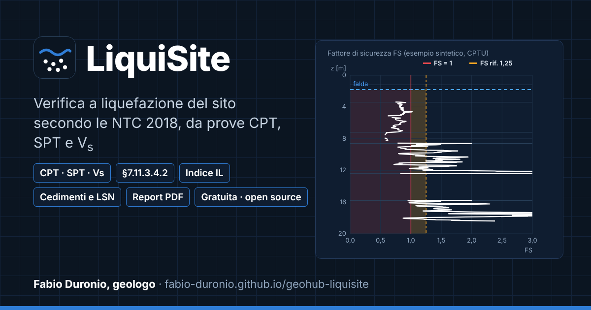

# LiquiSite

**Verifica a liquefazione del sito secondo le NTC 2018**, direttamente nel browser.

**[Apri l'app →](https://fabio-duronio.github.io/geohub-liquisite/)**

Applicazione web per geologi e ingegneri della famiglia GeoHub. A partire dalle prove in sito (CPT/CPTU, SPT, misure di V_s) esegue la verifica preliminare di esclusione e la verifica a liquefazione con i metodi semplificati, secondo il **D.M. 17/01/2018 (NTC 2018)** e la **Circolare n. 7/2019**. Non richiede installazione né registrazione: i calcoli avvengono nel browser e nessun dato viene inviato a server.

## Cosa fa

- **Verifica preliminare (§7.11.3.4.2)**: i quattro criteri di esclusione.
  - I criteri 1 e 2 si valutano sul sito.
  - I criteri 3 e 4 si valutano per strato, con la curva granulometrica disegnata sui fusi della Fig. 7.11.1. L'esito del criterio 4 è proposto dall'app e confermato dal geologo con motivazione.
- **Fattore di sicurezza punto per punto** con metodi letti sulle pubblicazioni originali:

  | Prova | Metodo | Ruolo |
  |---|---|---|
  | CPT/CPTU | Boulanger & Idriss (2014) | principale |
  | SPT | Boulanger & Idriss (2014) | principale o controllo |
  | SPT | Cetin et al. (2018) | principale o controllo |
  | V_s | Kayen et al. (2013) | solo confronto |

  Sono riportate anche le grandezze intermedie (CSR, CRR, r_d, K_σ, MSF, resistenze normalizzate) e, dove il metodo la prevede, la probabilità di liquefazione P_L.
- **FS di riferimento** scelto dal progettista: predefinito 1,25 (EN 1998-5, §4.1.4), mostrato nei grafici e nel riepilogo. Le NTC non fissano un valore minimo.
- **Indice del potenziale di liquefazione IL** (Iwasaki et al. 1978), senza classi. Se la verticale non è indagata per intero fino a 20 m, l'indice è dato come intervallo minimo–massimo.
- **Cedimento post-sismico e indice LSN** da CPT, con le equazioni originali di Zhang et al. (2002). Anche qui i tratti non indagati sono dati come intervalli.
- **Carta di comportamento del terreno** (Robertson & Wride 1998) con i punti della CPT.
- **Confronto tra scenari**: fino a 3, con falda, metodo, magnitudo o accelerazione diversi.
- **Importazione** da foglio elettronico o CSV, con scelta esplicita di separatori, colonne e unità. Gli errori sono segnalati con riga e colonna.
- **Stampa A4 verticale come allegato alla relazione**:
  - dati;
  - verifica preliminare;
  - riepilogo;
  - profili;
  - carta di comportamento;
  - avvisi e assunzioni.
- **Esportazioni**: CSV dei risultati (separatore «;», virgola decimale), PNG dei grafici, progetto in JSON da riaprire.

I tratti non indagati o non calcolati non sono mai considerati sicuri.

## Come si usa

1. Premi **Demo sintetica** per provare il percorso con dati inventati, oppure **Nuovo** per iniziare.
2. In **Prove** inserisci o incolla i dati della prova; in **Scenario** scegli il metodo, la magnitudo M_w e l'accelerazione a_max al sito.
3. In **Stratigrafia** indica la falda e gli strati (pesi di volume, contenuto di fini se disponibile).
4. Premi **Calcola** e consulta la verifica preliminare, i profili, le tabelle e gli avvisi.
5. Per allegare i risultati alla relazione usa **Stampa / PDF** (consigliati Chrome o Edge). Salva il progetto in JSON per riprenderlo.

## Perimetro d'uso

È uno strumento di supporto per il professionista e **non** sostituisce la relazione geologica e geotecnica.

**Cosa non fa:**
- non sceglie M_w né a_max;
- non impone un fattore di sicurezza minimo;
- non usa classi o zone della microzonazione sismica;
- non calcola gli spostamenti laterali;
- non converte le prove DPSH o le CPT a punta meccanica in dati equivalenti.

Le scelte di progetto e l'impiego dei risultati restano a carico del professionista. Dettagli in [Uso e limiti](docs/app.md#limiti).

## Documentazione

- [Metodo di calcolo](docs/metodo.md): equazioni, fonti, refusi delle fonti, criteri di esclusione
- [Indice IL](docs/indice-il.md) e [Cedimenti e LSN](docs/cedimenti-lsn.md)
- [Uso e limiti dell'applicazione](docs/app.md)
- [Validazione](docs/validazione.md): verifiche automatiche, seconda implementazione indipendente, confronto con un calcolo pubblicato
- [Sviluppo](docs/sviluppo.md): struttura del repository, avvio in locale, formato del progetto
- [Novità delle versioni](CHANGELOG.md)
- Per segnalare una discrepanza di calcolo o proporre una funzione usa la scheda [Issues](https://github.com/fabio-duronio/geohub-liquisite/issues/new/choose)

## Licenza e citazione

Copyright © 2026 Fabio Duronio, geologo. Licenza **GNU AGPL-3.0** con termini aggiuntivi ([LICENSE](LICENSE), [NOTICE](NOTICE)):

- **Uso libero**, anche professionale, per relazioni, progetti e studi.
- **Chi modifica o ridistribuisce** il codice, anche come servizio web, deve rilasciarlo con la stessa licenza e renderne disponibile il sorgente.
- **Attribuzione obbligatoria**: le versioni derivate riportano nell'interfaccia "Basato su LiquiSite di Fabio Duronio, geologo" con il link a questo repository.
- **Nomi**: "LiquiSite" e "GeoHub" non sono concessi in licenza; le versioni modificate usano un nome diverso.
- **Licenze commerciali** diverse dalla AGPL sono disponibili su richiesta.

Per citare lo strumento: *Duronio F., LiquiSite (GeoHub-LiquiSite), verifica a liquefazione del sito secondo NTC 2018, versione X.Y.Z, https://github.com/fabio-duronio/geohub-liquisite*.
